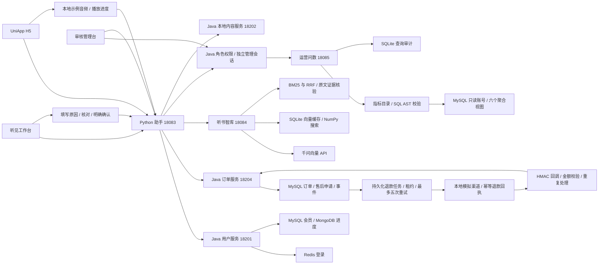

# 听见 · 架构与演示

## 项目定位

以听书业务作为 Java 项目的主线，把个人业务查询、售后状态流程、知识检索、运营统计放进同一工作台。目标是展示业务接口与 AI 工具的边界、可核验结果、身份隔离、指标口径和可复现的联调过程。

## 服务职责

| 服务 | 职责 |
| --- | --- |
| 用户服务 | 听友与管理员身份、RBAC、会员、收听进度 |
| 内容服务 | 分类、公开专辑、章节与试听信息 |
| 订单服务 | 定价、订单、售后状态机、模拟支付退款与审计 |
| 助手服务 | 用户端与管理端入口、身份代理、查询工具编排、会话 |
| 知识服务 | 章节切分、混合检索、向量缓存、原文证据核验 |
| 运营服务 | 指标目录、SQL 生成与校验、只读执行、查询审计 |

## 调用链

## 需要讲清楚的设计

个人工具不接收 userId。浏览器传递登录 token，Java 认证决定身份；会话也绑定该身份，不能读取其他用户的会话。模型工具参数必须符合白名单，不能要求查询另一个用户。

业务事实采用固定格式。进度记录没有书名与集数时明确说明未知；会员根据到期时间判断，统一显示北京时间。模型负责选择工具，不能把声音 ID 解释成集数，也不能凭前文猜测当前正在收听哪本书。

知识服务先检索，再让模型选择原文。每条引用记录文件、章节、稳定片段 ID 和证据文字。服务拒绝不存在的片段 ID 与改写的引用，最后回答直接采用验证后的证据。这是提取式 RAG；未来如加入自由总结，需要单独评测事实一致性。

运营问数先定义口径，再生成 SQL。模型声明的视图不作为权限依据，服务从 AST 中确定实际视图；执行前再次校验。数据库账号只有聚合视图的 SELECT 权限，没有原始个人信息读取或写入权限。SQL 结果不再交给模型猜测，直接展示表格、口径、SQL 和审计编号。

售后交易状态由 Java 决定。助手可查询订单与申请，模型没有提交、撤回或退款工具。用户在页面填写原因，服务保存 DRAFT 和订单金额快照；页面核对后发送 confirmed=true，Java 再核验订单归属、支付状态、金额与 10 分钟有效期，登记 SUBMITTED。同一订单统一先锁订单，再锁申请；申请和事件同一事务落库，重复请求复用状态。WITHDRAWN 表示申请撤回，EXPIRED 表示草稿超时；SUBMITTED 表示待人工审核；管理员可转为 APPROVED 或 REJECTED，持久化审核意见和真实操作人，用户页面回显。APPROVED 明确表示审核通过但尚未退款。退出页面或重启后可以从数据库恢复申请，不依赖模型记忆。

当前语料为 12 份文件、120 个片段，使用本地持久化向量与 NumPy 搜索便于复现。大规模语料下需要评估向量数据库、分片、增量索引和重排序；本次没有虚构压测或大规模性能数据。

## 五分钟演示顺序

1. 用H5 登录，搜索并播放标记为本地示例的音频，展示暂停保存和刷新恢复进度。
2. 问《三体》用户评论中的阅读门槛，展开原文引用；再提问沙漠生活与旅行见闻，展示语义召回。说明这是提取式 RAG。
3. 查询我的订单/进度，展示 Java 身份隔离与多轮历史。越权个人数据和写入问数请求被拒绝。
4. 在“我的订单与售后”创建 ¥9.90 本地演示订单，核对并模拟支付成功。此过程不扣款、不开放付费内容。
5. 填写原因、核对草稿并确认登记；管理台填写意见后审核通过。说明 APPROVED 尚未退款。
6. 管理员选择“已受理但响应丢失”并确认本地模拟退款；刷新显示任务尝试两次后 SUCCEEDED，用户显示 REFUNDED。展开审计说明只有一份渠道回执。
7. 管理员问平台专辑和声音总数，展示聚合视图、SQL、口径与审计；说明示例音源与真实可播放音源不同。
8. 展示固定评测报告和启动脚本，重点说明回调幂等、MySQL 当前读、租约恢复、限流超时、引用核验与 SQL 双重权限。

录制素材与字幕短片见 [演示说明](演示/演示说明.md)。短片由真实网页截图组成，完整五分钟现场演示按上述流程执行。

## 当前可核验结果

| 验收 | 最新结果 | 范围 |
| --- | --- | --- |
| Java 单测 | 36 项通过 | 售后16、支付退款13、权限5、用户2 |
| Python 单测 | 99 项通过 | 模型配置、RAG/SQL、认证、请求治理 |
| H5 构建 | 通过 | UniApp 工程；未接入页面仍有警告 |
| 本地交易实际服务 | 30 项通过 | MySQL并发、HMAC/金额、重试上限、实际重启恢复 |
| 固定真实向量 Top-5 | 16/16 通过 | 12份文件120片段，小样本召回证据 |
| 真实 Agent 评测 | 20/20 通过 | 多轮、工具路由、引用、拒答、问数和权限边界 |
| 前两阶段实际服务 | 34 项通过 | 审核并发、角色撤销、分页、MP3 Range、进度隔离 |

当前保存的 DeepSeek deepseek-flash 与百炼 text-embedding-v3（1024维）真实连接成功。历史 Arrearage 欠费报告保留作为过去记录，不能当作当前状态。真实 API 结果受供应商额度、网络与模型版本影响；固定测试集通过不代表通用准确率。

退款使用本地模拟渠道。服务端事务、渠道幂等回执、回调校验及重启恢复均已实际验证；没有接入真实资金、付费播放授权、云点播、微信真机。不要把初始化数据规模当成项目用户规模，也不要虚构性能提升。

部署和报告路径见 [部署与验收](部署与验收.md)，交易状态和接口见 [支付退款设计与接口](支付退款设计与接口.md)，面试表述见 [求职项目提纲](求职项目提纲.md)。
